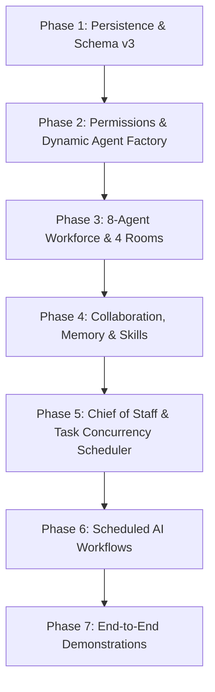

# OpenCrewBot 2.0 — Master Engineering & Implementation Plan

**Document:** Comprehensive Master Implementation Roadmap  
**Target File:** `docs/CORE_WORKFORCE_IMPLEMENTATION_PLAN.md`  
**Version:** 2.0-FINAL  
**Date:** 2026-11-18  
**Author:** Antigravity AI Engineering Assistant  
**Status:** Approved for Review (Zero source code modifications until explicit user approval)  

---

## Executive Summary

This master implementation plan establishes the engineering sequence to deliver **every requirement of Assignment 3: OpenCrewBot 2.0**. All work builds incrementally upon the verified MIT-licensed codebase and the 59 passing baseline tests.

---

## 1. Phased Roadmap Overview



---

## 2. Complete Assignment Requirements Matrix

The 16 core assignment requirements are distributed across 7 phases:

| Phase | Core Objective | Assignment Requirements Satisfied | New Test Suites |
|---|---|---|---|
| **Phase 1** | Schema v3 & Task Persistence | Task Engine Data Model, Failure & Crash Recovery, History Tracking | `tests/db-v3.test.ts` |
| **Phase 2** | Permissions & Agent Factory | Dynamic Agent Creation, 3 Permission Tiers, Approval Center | `tests/agent-factory.test.ts`, `tests/permissions.test.ts` |
| **Phase 3** | Workforce & Multi-Model Intelligence | 8 Configurable Agents, 4 Collaboration Rooms, Multi-Model Routing, Cost Tracking | `tests/workforce-seed.test.ts`, `tests/models-multi.test.ts` |
| **Phase 4** | Collaboration, Memory & Skills | Structured Multi-Agent Collaboration, 8 Reusable Skills, 3 Working Integrations | `tests/collaboration.test.ts`, `tests/skills.test.ts` |
| **Phase 5** | Chief of Staff & Scheduler | Intelligent Chief of Staff, Concurrency Scheduler, Cancellation Propagation | `tests/chief-of-staff.test.ts`, `tests/task-engine.test.ts` |
| **Phase 6** | Scheduled AI Workflows | Background Cron Engine, Recurring Tasks, Interval Health Checks | `tests/scheduler.test.ts` |
| **Phase 7** | Demos & Final Verification | All 7 Business Demonstrations, Final Submission Documentation | `tests/demos.test.ts` |

---

## 3. Concurrency Scheduler & Cancellation Architecture (Phase 5 Detail)

### 3.1 Task Concurrency Scheduler Mechanics
- **Location:** `src/lib/server/task-engine.ts`
- **Global Concurrency Ceiling:** `MAX_GLOBAL_CONCURRENCY = 6`. Enforced via a central semaphore counter `activeGlobalCount`.
- **Per-Agent Serialization:** `activeAgentLocks = new Map<string, string>()` (maps `botId` to `taskId`). Strictly 1 active task per agent system-wide.
- **Per-Agent FIFO Queues:** `agentQueues = new Map<string, Task[]>()`. If `@scout` is running, subsequent tasks assigned to `@scout` enqueue in `@scout`'s FIFO queue.
- **Atomic Task Claiming:**
  ```sql
  UPDATE tasks 
  SET status = 'running', started_at = ? 
  WHERE id = ? AND status = 'ready';
  ```
  Only if `changes === 1` does the engine acquire the execution lock, preventing race conditions across concurrent plans.
- **Unified Plan Conversation ID:** Tasks within a plan dispatch to `runtime.ts:runTurn()` with `conversationId = "plan:" + planId`, allowing secondary queue serialization via `runtime.ts:key("plan:" + planId, botId)`.

---

### 3.2 Hierarchical Cancellation Propagation
1. **Plan Cancellation:** Calling `cancelPlan(planId)` sets `plans.status = 'cancelled'`.
2. **Active Task Abortion:** 
   - `taskAbortControllers.get(taskId)?.abort()` fires immediately.
   - `runtime.ts:stopConversation("plan:" + planId)` increments the stop epoch and aborts the live Mastra session.
3. **Queued Task Purge:** Unstarted tasks in `agentQueues` are removed and marked `status: 'cancelled'` in SQLite.
4. **Suspended Approval Cleanup:** Tasks in `awaiting_approval` transition to `cancelled`. Subsequent approval attempts return `400 Bad Request`.
5. **Zero-Restart Guarantee:** Tasks marked `cancelled` are terminal and ignored by crash recovery.

---

### 3.3 Task Identity Strategy
- **Unique UUID:** Every task has an immutable UUID (`randomUUID()`).
- **Plan-Scoped Step Index:** Each task carries a `stepIdentifier` (e.g. `step_1_research`, `step_2_modeling`).
- **Composite Unique Constraint:** SQLite enforces `UNIQUE(plan_id, step_identifier)` preventing duplicate tasks while allowing legitimate multiple tasks with similar titles.
- **Idempotency Key:** `createPlan(input, idempotencyKey)` returns an existing plan if re-submitted.

---

### 3.4 Crash Recovery Invariants on Server Startup
- **`running` tasks:** If `retryCount < maxRetries`, transition to `ready` with exponential backoff and retry count increment. If max retries reached, transition to `failed`.
- **`awaiting_approval` tasks:** **PRESERVED IN `awaiting_approval`**. A server restart never silently executes an unapproved action.
- **`ready` tasks:** Re-enqueued into `agentQueues` on boot.
- **`cancelled` / `completed` / `failed` tasks:** Preserved as terminal.

---

## 4. Phase-by-Phase Technical Specifications

### Phase 1: Database Persistence & Schema v3 (Isolated Foundation)

#### Scope of Phase 1
Phase 1 focuses **exclusively on database persistence, Schema v3 DDL, and task storage CRUD**. It introduces zero orchestration logic, touches no UI components, and guarantees backward compatibility.

#### Exact Files to Modify
- `src/lib/server/db.ts`: Increment `SCHEMA_VERSION = 3`; append DDL for `plans` and `tasks` tables with indexes.

#### Exact Files to Create
- `src/lib/server/task-store.ts`: Domain CRUD functions:
  - `createPlan(plan: PlanData): Promise<void>`
  - `getPlan(id: string): Promise<PlanData | null>`
  - `saveTask(task: TaskData): Promise<void>`
  - `getTasksByPlan(planId: string): Promise<TaskData[]>`
  - `updateTaskStatus(id: string, status: TaskStatus, output?: string, error?: string): Promise<void>`
  - `claimReadyTask(id: string): Promise<boolean>`
  - `recoverStuckTasks(): Promise<{ recovered: number; failed: number }>`
- `tests/db-v3.test.ts`: Isolated unit test suite covering Schema v3 operations.

#### Migration Steps in `db.ts`
1. Update `SCHEMA_VERSION = 3`.
2. Append DDL to `open()` batch:
   ```sql
   CREATE TABLE IF NOT EXISTS plans (
     id TEXT PRIMARY KEY,
     conversation_id TEXT NOT NULL,
     status TEXT NOT NULL,
     created_at TEXT NOT NULL,
     data TEXT NOT NULL
   );
   CREATE INDEX IF NOT EXISTS plans_by_conv ON plans (conversation_id, created_at);

   CREATE TABLE IF NOT EXISTS tasks (
     id TEXT PRIMARY KEY,
     plan_id TEXT NOT NULL,
     step_identifier TEXT NOT NULL,
     assigned_bot_id TEXT NOT NULL,
     status TEXT NOT NULL,
     created_at TEXT NOT NULL,
     data TEXT NOT NULL,
     UNIQUE(plan_id, step_identifier)
   );
   CREATE INDEX IF NOT EXISTS tasks_by_plan ON tasks (plan_id, status);
   CREATE INDEX IF NOT EXISTS tasks_by_bot ON tasks (assigned_bot_id, status);
   ```

#### Verification Gate
- `pnpm test tests/db-v3.test.ts` (All new tests pass).
- Full suite: `pnpm test` (All 59 existing tests pass without regressions).

---

### Phase 2: Three-Tier Permission Architecture & Dynamic Agent Factory
- **Files Modified:** `src/lib/shared/types.ts`, `src/lib/server/tools.ts`, `src/lib/server/runtime.ts`
- **Files Created:** `src/lib/server/agent-factory.ts`, `tests/agent-factory.test.ts`, `tests/permissions.test.ts`
- **Deliverables:**
  - `Bot.approval` extended to `"ask_first" | "controlled" | "full"`.
  - Natural-language `create_agent` tool wrapping `service.createBot()`.
  - Gated approval card for agent creation.
  - Automatic handle collision resolution (e.g. `ledger_2`).

---

### Phase 3: 8-Agent Workforce, 4 Rooms & Model Router
- **Files Modified:** `src/lib/server/service.ts`, `src/lib/server/models.ts`
- **Files Created:** `tests/workforce-seed.test.ts`, `tests/models-multi.test.ts`
- **Deliverables:**
  - Seed 8 agents: `@chief`, `@scout`, `@quill`, `@atlas`, `@cipher`, `@ledger`, `@sentry`, `@chronos`.
  - Seed 4 rooms: `Executive War Room`, `Research & Intel Lab`, `Engineering & Architecture`, `Operations & Workflows`.
  - Align models with 18 verified static catalog models in `models.ts`.
  - Abstract multi-provider router (`resolveModelString`).

---

### Phase 4: Structured Collaboration, Shared Memory & 8 Skills
- **Files Created:** `src/lib/server/collaboration-tools.ts`, `src/lib/server/skills-registry.ts`, `tests/collaboration.test.ts`
- **Files Modified:** `src/lib/server/tools.ts`, `src/lib/server/memory-files.ts`
- **Deliverables:**
  - Structured tools: `delegate_subtask`, `ask_peer`, `verify_assumption`.
  - Shared room memory at `data/rooms/{roomId}/ROOM_MEMORY.md`.
  - 8 reusable skills (Research, Finance, Code, Security, QA, Docs, Cron, Synthesis).
  - Stack depth limit (`MAX_DELEGATION_DEPTH = 3`) and DAG cycle detection.

---

### Phase 5: Chief of Staff & Task Concurrency Scheduler
- **Files Created:** `src/lib/server/chief-of-staff.ts`, `src/lib/server/task-engine.ts`, `tests/chief-of-staff.test.ts`, `tests/task-engine.test.ts`
- **Deliverables:**
  - Chief of Staff cognitive orchestrator (`plan_workflow`).
  - Concurrency Scheduler with global semaphore (max 6) and per-agent FIFO queues.
  - Hierarchical cancellation engine.
  - Multi-agent result synthesis pipeline.

---

### Phase 6: Scheduled AI Workflows
- **Files Created:** `src/lib/server/scheduler.ts`, `tests/scheduler.test.ts`
- **Files Modified:** `src/lib/server/service.ts`
- **Deliverables:**
  - Background cron & interval runner initialized in `service.init()`.
  - Periodic automated task dispatch to rooms.

---

### Phase 7: End-to-End Business Demonstrations & Final Submission
- **Deliverables:**
  - Verify all 7 business demonstrations via automated integration test scripts:
    1. Dynamic Agent Onboarding
    2. Autonomous Market & Financial Initiative
    3. Collaborative Systems Architecture
    4. Human-in-the-Loop Controlled Execution
    5. Recurring Scheduled Autonomous Workflow
    6. Multi-Model Routing & Cost Tracking
    7. Resilient Failure Recovery & Cancellation
  - Complete Markdown documentation suite for final submission.

---

## 5. Protected Architecture Principles

1. **Do Not Rewrite `src/lib/server/runtime.ts`:**  
   The runtime harness manages session lifecycles, turn queues, and Mastra event folding correctly. Extensions hook in via tools (`tools.ts`) and domain services (`service.ts`).
2. **Preserve Baseline Tests:**  
   The 59 passing tests must continue to run and pass on every subsequent phase.
3. **Strict Isolation:**  
   All new tests will load `tests/setup.ts` to ensure execution against ephemeral temporary directories.

---
*Master Implementation Plan Complete. Awaiting user approval to begin Phase 1.*
