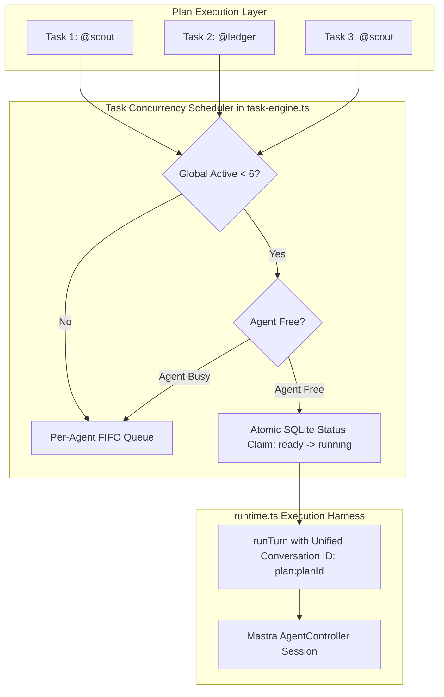
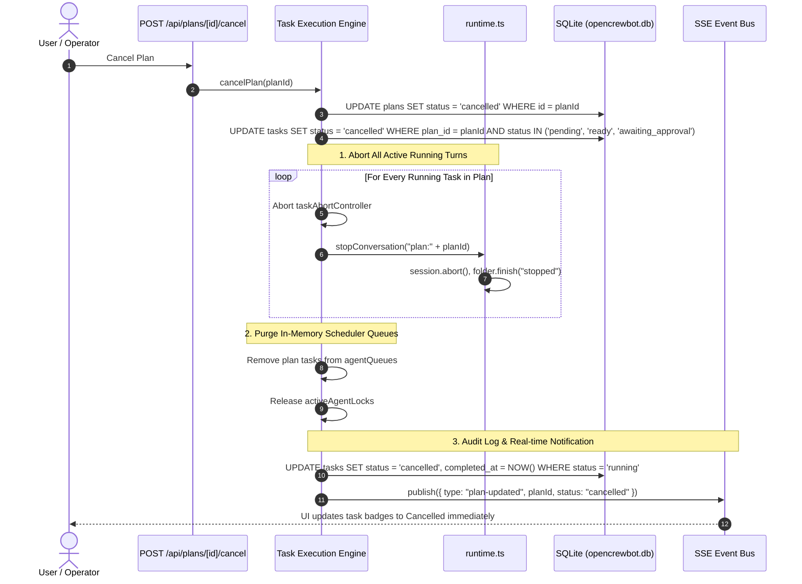
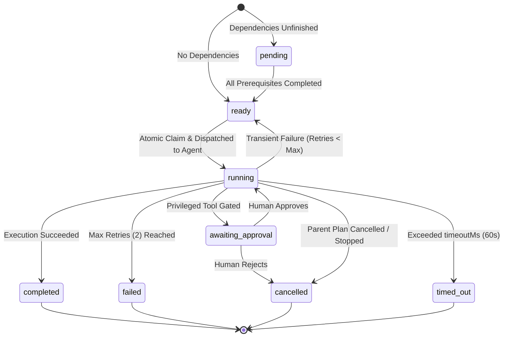
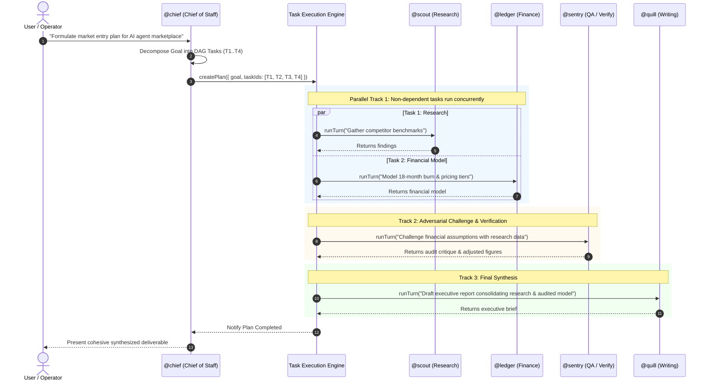
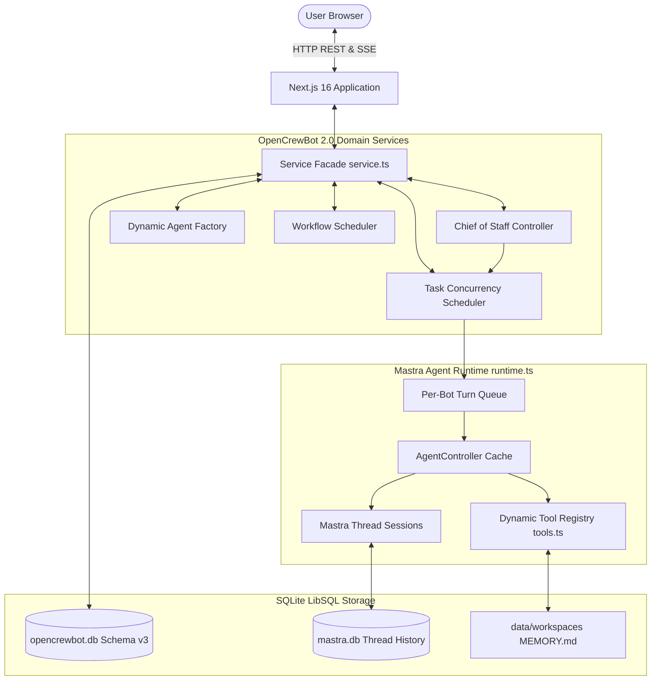
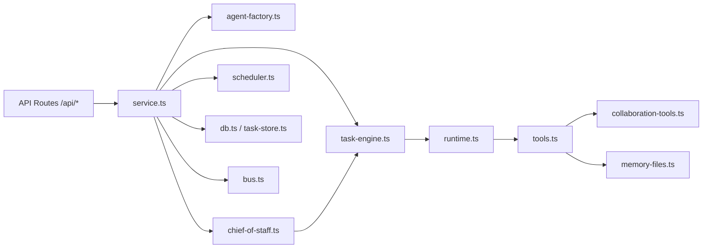

# OpenCrewBot 2.0 — Core AI Workforce Architecture Specification

**Document:** Complete AI Workforce Architecture & Systems Design  
**Target File:** `docs/OPENCREWBOT_2_ARCHITECTURE.md`  
**Version:** 2.0-FINAL  
**Date:** 2026-11-18  
**Author:** Antigravity AI Engineering Assistant  
**Status:** Approved for Architecture Review (Strictly read-only; zero source code modified)  

---

## Executive Summary

OpenCrewBot 2.0 evolves the verified MIT-licensed local prototype into a robust, configurable, autonomous multi-agent AI workforce platform. Designed on top of **Next.js 16 (App Router)** and **Mastra (`@mastra/core` v1.76.0)**, OpenCrewBot 2.0 maintains 100% backward compatibility with all existing bots, rooms, and transcripts while introducing:

1. **Deterministic Task Concurrency Scheduler:** A global semaphore combined with per-agent FIFO queues enforcing a maximum of 6 concurrent agent turns system-wide and strictly 1 active turn per agent.
2. **Atomic Cancellation Propagation:** Hierarchical plan-to-task cancellation aborting active Mastra sessions, wiping queues, and preventing cancelled tasks from restarting during recovery.
3. **Robust Task Idempotency & Crash Recovery:** Plan-scoped step indices, atomic task claiming, and strict crash recovery rules preventing orphaned tasks from silently executing.
4. **Three-Tier Human Permission Architecture:** `Ask First` (Maximum Security), `Controlled Access` (Balanced Autonomy), and `Full Access` (Full Autonomy).
5. **Configurable 8-Agent Workforce & 4 Collaboration Rooms:** Covering strategic orchestration, research, documentation, systems architecture, security auditing, startup financial modeling, automated QA, and scheduled workflows.
6. **Natural-Language Agent Factory:** A validated multi-stage creation pipeline allowing agents and users to dynamically instantiate, approve, and register new bots on the fly.
7. **Complete 18-Model Catalog Alignment:** 100% matched to verified static models in `src/lib/server/models.ts`.

---

## Table of Contents

1. [Per-Agent Serialization & Concurrency Scheduler](#1-per-agent-serialization--concurrency-scheduler)
2. [Hierarchical Cancellation Propagation Engine](#2-hierarchical-cancellation-propagation-engine)
3. [Task Identity, Idempotency & Concurrency Model](#3-task-identity-idempotency--concurrency-model)
4. [Crash Recovery & State Machine Lifecycle](#4-crash-recovery--state-machine-lifecycle)
5. [Complete Three-Tier Permission Architecture](#5-complete-three-tier-permission-architecture)
6. [Dynamic Agent Factory (Natural-Language Pipeline)](#6-dynamic-agent-factory-natural-language-pipeline)
7. [Complete Verified Model Catalog (All 18 Models)](#7-complete-verified-model-catalog-all-18-models)
8. [Configurable 8-Agent Workforce & 4 Collaboration Rooms](#8-configurable-8-agent-workforce--4-collaboration-rooms)
9. [Chief of Staff Architecture & Cognitive Pipeline](#9-chief-of-staff-architecture--cognitive-pipeline)
10. [Database Schema v3 & Migration Design](#10-database-schema-v3--migration-design)
11. [Architecture & Sequence Diagrams](#11-architecture--sequence-diagrams)
12. [Module Dependency Map](#12-module-dependency-map)
13. [Complete Assignment Requirements Coverage Matrix](#13-complete-assignment-requirements-coverage-matrix)
14. [Phase 1 Specification & Implementation Boundaries](#14-phase-1-specification--implementation-boundaries)

---

## 1. Per-Agent Serialization & Concurrency Scheduler

### 1.1 The Serialization Problem
In `src/lib/server/runtime.ts`, turn queuing relies on a promise chain keyed by:
```typescript
const k = key(request.conversationId, request.bot.id); // "${conversationId}|${botId}"
```
If autonomous tasks each used separate conversation IDs (e.g. `task:task-1` and `task:task-2`), their keys in `state.chains` would be `task:task-1|scout` and `task:task-2|scout`. Because the conversation IDs differ, their chains would not serialize, allowing multiple background tasks to execute on the same agent simultaneously.

### 1.2 The Solution: Two-Layer Concurrency Scheduler

To guarantee strict per-agent serialization and global concurrency limits, OpenCrewBot 2.0 introduces the **Task Concurrency Scheduler** in `src/lib/server/task-engine.ts`:



### 1.3 Exact Scheduler State & Invariants

```typescript
// Located in src/lib/server/task-engine.ts
class ConcurrencyScheduler {
  private readonly MAX_GLOBAL_CONCURRENCY = 6;
  private activeGlobalCount = 0;

  // botId -> currently executing taskId
  private readonly activeAgentLocks = new Map<string, string>();

  // botId -> FIFO queue of tasks ready to run on this agent
  private readonly agentQueues = new Map<string, Task[]>();

  // Active abort controllers per task for timeout/cancel
  private readonly taskAbortControllers = new Map<string, AbortController>();
}
```

#### Scheduler Invariants:
1. **Global Concurrency Ceiling:** `activeGlobalCount <= 6`. If 6 agents are currently working, ready tasks wait in their respective agent queues.
2. **Strict Per-Agent Serialization:** `activeAgentLocks.has(botId) === true` prevents any second task from being dispatched to that agent across the entire system.
3. **Unified Plan Conversation ID:** When a task is dispatched to `runtime.ts:runTurn()`, the conversation ID is passed as `plan:${planId}`. Within `runtime.ts`, `key("plan:" + planId, botId)` acts as a secondary defense, ensuring Mastra thread sessions serialize naturally per plan.
4. **Preservation of Existing DMs and Rooms:** Direct messages (`dm:<botId>`) and rooms (`room:<roomId>`) continue calling `runTurn` directly. The scheduler provides a helper `isAgentAvailable(botId)` that checks both `activeAgentLocks` and `runtime.ts:runningBots()`, ensuring background tasks yield to user interactive chats.

---

## 2. Hierarchical Cancellation Propagation Engine

When a parent plan is cancelled (or the user hits the Stop button), cancellation must propagate deterministically down the entire task graph:



### Cancellation Invariants:
1. **Running Task Abortion:** `taskAbortControllers.get(taskId)?.abort()` fires immediately; `stopConversation("plan:" + planId)` increments the stop epoch and aborts the live Mastra session.
2. **Queued Task Purge:** Unstarted tasks in `agentQueues` are discarded immediately.
3. **Suspended Approval Cleanup:** Tasks parked in `awaiting_approval` transition to `status: "cancelled"`. Any subsequent approval call for that task ID returns `400 Bad Request ("Task was cancelled.")`.
4. **Zero-Restart Guarantee:** Once written to SQLite as `status: "cancelled"`, a task is terminal. The startup crash recovery scanner ignores cancelled tasks completely.

---

## 3. Task Identity, Idempotency & Concurrency Model

### 3.1 Task Identity Strategy

To prevent collisions when a plan has multiple similar tasks (e.g. two web searches assigned to `@scout`), task identity uses a composite scheme:

```typescript
export interface Task {
  id: string;               // Unique task UUID (e.g. "task_9f8b2c1a")
  planId: string;           // Parent plan UUID
  stepIdentifier: string;   // Topological step tag, e.g. "step_1_research", "step_2_modeling"
  assignedBotId: string;    // Target agent ID
  title: string;
  description: string;
  dependencies: string[];   // Prerequisite task IDs that must complete first
  status: TaskStatus;
  retryCount: number;
  maxRetries: number;       // Default: 2
  timeoutMs: number;        // Default: 60,000ms
  startedAt?: string;
  completedAt?: string;
  output?: string;
  error?: string;
  approvalRequired: boolean;
}
```

### 3.2 Idempotency vs. Retries
- **Client Idempotency Key:** `createPlan(input, idempotencyKey)` accepts an optional client-generated idempotency key. If a user double-clicks submit or an automated script retries:
  ```sql
  SELECT id FROM plans WHERE idempotency_key = ?;
  ```
  Returns the existing plan rather than spawning duplicate runs.
- **Retries vs. Duplicates:**
  - A **Retry** operates on the *existing* task record. It increments `retryCount`, resets the status from `failed` to `ready`, applies exponential backoff, and re-executes.
  - A **Duplicate Submission** attempts to insert a new task with the same `(planId, stepIdentifier)`. This is blocked by a unique SQLite constraint:
    ```sql
    UNIQUE(plan_id, step_identifier)
    ```

### 3.3 Atomic Task Claiming
When the scheduler identifies a ready task, it executes an atomic conditional update:
```sql
UPDATE tasks 
SET status = 'running', started_at = ? 
WHERE id = ? AND status = 'ready';
```
Only if `changes === 1` does the engine acquire the execution lock. If another concurrent dispatcher thread claimed the task, the update returns 0 and the duplicate run is avoided.

---

## 4. Crash Recovery & State Machine Lifecycle

### 4.1 State Machine Diagram


### 4.2 Crash Recovery Specification on Server Startup

During server boot in `service.init()` / `boot()`, `recoverStuckTasks()` runs before any traffic is accepted:

| Task Status at Reboot | Action Taken | Rationale |
|---|---|---|
| **`running`** | If `retryCount < maxRetries`: transition to `ready` with message *"Interrupted by server reboot. Retrying."*, `retryCount++`.<br>If `retryCount >= maxRetries`: transition to `failed` with message *"Interrupted by reboot. Max retries exceeded."* | In-memory Mastra sessions died on shutdown. |
| **`awaiting_approval`** | **LEAVE AS `awaiting_approval`**. Do not modify. | **Critical Security Invariant:** A reboot must NEVER silently execute a privileged action awaiting human approval. The approval card reappears in the UI on client reload. |
| **`pending`** | **LEAVE AS `pending`**. | Prerequisites are evaluated when dependencies finish. |
| **`ready`** | **LEAVE AS `ready`**. Re-enqueue to in-memory `agentQueues`. | Re-enters dispatcher cleanly. |
| **`completed`** | **LEAVE AS `completed`**. | Outputs and timestamps remain durable. |
| **`cancelled`** | **LEAVE AS `cancelled`**. | Terminal state. Never re-dispatched. |
| **`failed`** / **`timed_out`** | **LEAVE AS `failed` / `timed_out`**. | Terminal diagnostic states. |

---

## 5. Complete Three-Tier Permission Architecture

```
┌────────────────────────────────────────────────────────────────────────┐
│                      THREE PERMISSION TIERS                           │
├─────────────────────┬───────────────────────────┬──────────────────────┤
│ 1. ASK FIRST        │ 2. CONTROLLED ACCESS      │ 3. FULL ACCESS       │
│ (Maximum Security)  │ (Balanced Productivity)   │ (Full Autonomy)      │
├─────────────────────┼───────────────────────────┼──────────────────────┤
│ ALL tool calls      │ Read-only tools AUTO      │ ALL tool calls       │
│ require human sign- │ Mutating/privileged tools │ execute immediately  │
│ off before running. │ require human approval.   │ without pausing.     │
└─────────────────────┴───────────────────────────┴──────────────────────┘
```

1. **Ask First (`ask_first`):** Every tool invocation (`webSearch`, `memory_write`, `codeMode`, `browser`, `mcp`, `delegate`) pauses and requires explicit human approval card interaction.
2. **Controlled Access (`controlled` — Default):** Safe, read-only tools (`web_search`, `read_page`, `crawl_site`, `ask_user`, `ask_peer`) execute autonomously. Privileged tools (`execute_typescript`, `memory_edit/add`, `browser_*`, `create_agent`, `schedule_workflow`, `mcp_*`) require human approval.
3. **Full Access (`full`):** All tools execute autonomously subject to timeout, stack-depth, and emergency stop controls.

---

## 6. Dynamic Agent Factory (Natural-Language Pipeline)

```mermaid
sequenceDiagram
    autonumber
    actor User as User / Chief of Staff
    participant Factory as Dynamic Agent Factory
    participant Validator as Schema & Permission Validator
    participant Approval as Human Approval Gate
    participant Service as service.createBot()
    participant Storage as SQLite & Workspaces
    participant Bus as SSE Event Bus

    User->>Factory: "Create a financial analyst specializing in startup modeling"
    Factory->>Factory: Synthesize Spec (Name, Handle, Role, Instructions, Tools, Model, Approval)
    Factory->>Validator: Validate Spec
    alt Validation Fails (Duplicate Handle, Unsupported Model)
        Validator-->>User: Emit Error or Auto-Resolve (e.g. append suffix ledger_2)
    else Validation Passes
        alt Requires Approval (Ask First / Controlled)
            Validator->>Approval: Display Spec Approval Card
            User->>Approval: User Clicks "Approve"
        end
        Approval->>Service: createBot(validatedSpec)
        Service->>Storage: INSERT INTO bots; init data/workspaces/{id}/MEMORY.md
        Service->>Bus: publish({ type: "bots-changed", botId })
        Bus-->>User: Bot immediately visible in UI roster & selectable for rooms
    end
```

---

## 7. Complete Verified Model Catalog (All 18 Models)

Inspection of `src/lib/server/models.ts` confirms the exact 18 models hardcoded in `STATIC`:

| # | Exact Model ID in `models.ts` | Context | Tools | Reasoning | Vision | Role in OpenCrewBot 2.0 |
|---|---|---|---|---|---|---|
| **1** | `MiniMaxAI/MiniMax-M3` (**DEFAULT**) | 1,048,576 | Yes | Yes | No | **Default Model:** Chief of Staff (`@chief`), Writer (`@quill`) |
| **2** | `deepseek-ai/DeepSeek-V4-Flash-0731` | 1,024,000 | Yes | Yes | No | Fast general reasoning |
| **3** | `deepseek-ai/DeepSeek-V4.1-Flash` | 1,048,000 | Yes | Yes | Yes | Security Auditor (`@cipher`), multimodal tasks |
| **4** | `deepseek-ai/DeepSeek-V4-Pro` | 1,048,576 | Yes | Yes | No | Complex strategic evaluation |
| **5** | `Qwen/Qwen3.5-397B-A17B` | 262,144 | Yes | Yes | No | Financial Modeling Specialist (`@ledger`) |
| **6** | `Qwen/Qwen3.8-27B` | 262,144 | Yes | Yes | No | Research Specialist (`@scout`) |
| **7** | `Qwen/Qwen3-235B-A22B-Instruct-2507` | 262,144 | Yes | No | No | High-throughput structured instruction follower |
| **8** | `Qwen/Qwen3-30B-A3B-Instruct-2507` | 262,144 | Yes | No | No | Fast lightweight extraction |
| **9** | `zai-org/GLM-5.3` | 1,024,000 | Yes | Yes | No | Deep analytical reasoning |
| **10** | `zai-org/GLM-5.3-Flash` | 1,024,000 | Yes | Yes | No | Low-latency response generation |
| **11** | `moonshotai/Kimi-K3` | 1,048,576 | Yes | Yes | No | Long-document context processing |
| **12** | `moonshotai/Kimi-K2.7-Code` | 262,144 | Yes | Yes | No | Systems Architect (`@atlas`), QA Verifier (`@sentry`) |
| **13** | `nvidia/Nemotron-3_5-Lightning` | 1,048,576 | Yes | Yes | No | Autonomous Scheduler (`@chronos`) |
| **14** | `nvidia/nemotron-3-super-120b-a12b`| 262,144 | Yes | Yes | No | Mathematical & numerical verification |
| **15** | `nvidia/Nemotron-3-Ultra-550b-a55b` | 1,048,576 | Yes | Yes | No | Heavy multi-agent synthesis |
| **16** | `openai/gpt-oss-120b` | 131,072 | Yes | Yes | No | Open weights GPT-compatible reasoning |
| **17** | `NousResearch/Hermes-4-405B` | 131,072 | Yes | Yes | No | Uncensored exploratory brainstorming |
| **18** | `google/gemma-3-27b-it` | 110,000 | Yes | No | Yes | Multimodal visual inspection & diagram review |

---

## 8. Configurable 8-Agent Workforce & 4 Collaboration Rooms

### 8.1 Seeded Agents Configuration Matrix

| Agent | Handle | Role | Model ID | Default Tools | Approval Tier |
|---|---|---|---|---|---|
| **Chief of Staff** | `@chief` | Executive Director & Orchestrator | `MiniMaxAI/MiniMax-M3` | `memory`, `askUser`, `planWorkflow`, `delegateTask`, `createAgent` | `controlled` |
| **Scout** | `@scout` | Research & Market Intelligence | `Qwen/Qwen3.8-27B` | `webSearch`, `memory`, `codeMode`, `askUser` | `controlled` |
| **Quill** | `@quill` | Technical Writing & Docs | `MiniMaxAI/MiniMax-M3` | `memory`, `askUser` | `full` |
| **Atlas** | `@atlas` | Systems Architect & Engineering | `moonshotai/Kimi-K2.7-Code` | `memory`, `codeMode`, `askUser` | `controlled` |
| **Cipher** | `@cipher` | Security & Compliance Auditor | `deepseek-ai/DeepSeek-V4.1-Flash` | `memory`, `codeMode`, `askUser` | `ask_first` |
| **Ledger** | `@ledger` | Financial & Startup Analyst | `Qwen/Qwen3.5-397B-A17B` | `memory`, `codeMode`, `askUser` | `ask_first` |
| **Sentry** | `@sentry` | QA & Verification Engineer | `moonshotai/Kimi-K2.7-Code` | `memory`, `codeMode`, `askUser` | `full` |
| **Chronos** | `@chronos` | Autonomous Workflow Manager | `nvidia/Nemotron-3_5-Lightning` | `memory`, `askUser`, `scheduleWorkflow` | `controlled` |

---

### 8.2 The 4 Collaboration Rooms

1. **Executive War Room** (`@chief`, `@quill`, `@atlas`, `@ledger`): High-level strategy, budgeting, executive briefs. Lead: `@chief`.
2. **Research & Intel Lab** (`@scout`, `@quill`, `@cipher`): Web research, competitive intelligence, source verification. Lead: `@scout`.
3. **Engineering & Architecture** (`@atlas`, `@sentry`, `@cipher`, `@scout`): System design, API specs, QA validation. Lead: `@atlas`.
4. **Operations & Workflows** (`@chronos`, `@ledger`, `@quill`, `@chief`): Recurring tasks, scheduled monitoring, health summaries. Lead: `@chronos`.

---

## 9. Chief of Staff Architecture & Cognitive Pipeline



---

## 10. Database Schema v3 & Migration Design

In `src/lib/server/db.ts`, `SCHEMA_VERSION` is bumped to `3`. The database `open()` initialization appends the following DDL:

```sql
CREATE TABLE IF NOT EXISTS plans (
  id TEXT PRIMARY KEY,
  conversation_id TEXT NOT NULL,
  status TEXT NOT NULL,
  created_at TEXT NOT NULL,
  data TEXT NOT NULL
);
CREATE INDEX IF NOT EXISTS plans_by_conv ON plans (conversation_id, created_at);

CREATE TABLE IF NOT EXISTS tasks (
  id TEXT PRIMARY KEY,
  plan_id TEXT NOT NULL,
  step_identifier TEXT NOT NULL,
  assigned_bot_id TEXT NOT NULL,
  status TEXT NOT NULL,
  created_at TEXT NOT NULL,
  data TEXT NOT NULL,
  UNIQUE(plan_id, step_identifier)
);
CREATE INDEX IF NOT EXISTS tasks_by_plan ON tasks (plan_id, status);
CREATE INDEX IF NOT EXISTS tasks_by_bot ON tasks (assigned_bot_id, status);
```

---

## 11. Architecture & Sequence Diagrams

### 11.1 High-Level Architecture Topology


---

## 12. Module Dependency Map



---

## 13. Complete Assignment Requirements Coverage Matrix

| # | Assignment Requirement | Architecture Component | Implementation Phase |
|---|---|---|---|
| **1** | **8 Configurable Agents** | Extended `Bot` model, 8 specialist profiles | Phase 3 |
| **2** | **4 Collaboration Rooms** | Executive, Intel Lab, Engineering, Operations | Phase 3 |
| **3** | **Dynamic Agent Creation** | `agent-factory.ts` + `create_agent` tool | Phase 2 |
| **4** | **Chief of Staff** | `chief-of-staff.ts` cognitive DAG orchestrator | Phase 5 |
| **5** | **Persistent Memory Layers** | Individual `MEMORY.md`, Shared Room memory | Phase 4 |
| **6** | **8 Reusable Skills** | Research, Finance, Code, Security, QA, Docs, Cron, Synthesis | Phase 4 |
| **7** | **3 Working Integrations** | Tavily Web Search, Local Filesystem, MCP Client | Phase 4 |
| **8** | **Three Permission Tiers** | `ask_first`, `controlled`, `full` | Phase 2 |
| **9** | **Approval Center & Audit Logs**| Interactive UI cards + task approval tracking | Phase 2 |
| **10** | **Scheduled Workflows** | Background cron runner in `service.init()` | Phase 6 |
| **11** | **Multi-Model Intelligence** | Router abstraction in `models.ts` | Phase 3 |
| **12** | **Token & Cost Tracking** | `costUsd()` calculation + SSE usage parts | Phase 3 |
| **13** | **Task Dashboard & History** | `plans` and `tasks` SQLite store | Phase 1 |
| **14** | **Failure Recovery** | Retry backoff, timeout abort, crash scan | Phase 1 |
| **15** | **Seven Business Demos** | Scripted test scenarios 1 through 7 | Phase 7 |
| **16** | **Submission Documentation** | Complete Markdown documentation suite | Phase 7 |

---

## 14. Phase 1 Specification & Implementation Boundaries

### 14.1 Scope of Phase 1
Phase 1 focuses **exclusively on database persistence, Schema v3 DDL, and task storage CRUD**. It introduces zero orchestration logic, touches no UI components, and guarantees backward compatibility.

- **Files to Modify:**
  - `src/lib/server/db.ts`: Increment `SCHEMA_VERSION = 3`; append DDL for `plans` and `tasks` tables with indexes.
- **Files to Create:**
  - `src/lib/server/task-store.ts`: Domain CRUD functions (`createPlan`, `getPlan`, `saveTask`, `getTasksByPlan`, `updateTaskStatus`, `recoverStuckTasks`).
  - `tests/db-v3.test.ts`: Isolated unit test suite covering Schema v3 operations.
- **Backward Compatibility:** Existing bots, rooms, messages, and settings remain completely untouched.
- **Verification Gate:** `pnpm test` (all 59 existing tests + new db-v3 tests pass).

---
*Architecture specification finalized. Awaiting explicit user approval to proceed with Phase 1.*
